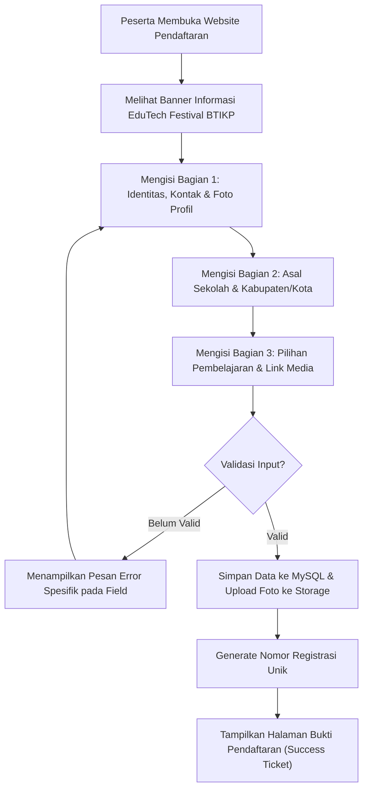
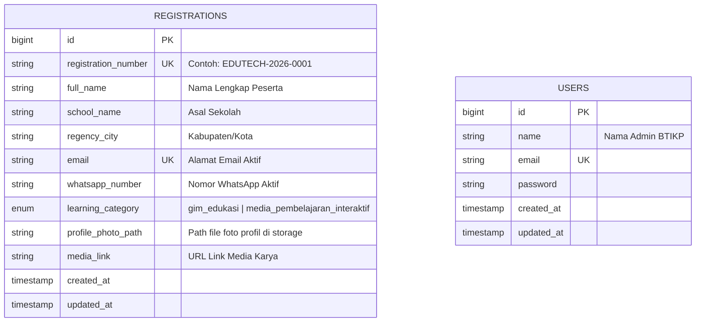

# Product Requirements Document (PRD)
## Website Pendaftaran EduTech Festival BTIKP (`edutech-festival-btikp`)

| Informasi Dokumen | Detail |
| :--- | :--- |
| **Nama Proyek** | `edutech-festival-btikp` |
| **Instansi** | BTIKP Dinas Pendidikan dan Kebudayaan Provinsi Sulawesi Tenggara |
| **Jenis Aplikasi** | Web Application — Interactive Event & Karya Registration Form |
| **Tech Stack** | Laravel, MySQL, Tailwind CSS, Alpine.js |
| **Status Dokumen** | Draft v1.0 |
| **Tanggal** | 2 November 2026 |

---

## 1. Latar Belakang & Tujuan Proyek

### 1.1 Latar Belakang
Kegiatan **EduTech Festival BTIKP** memerlukan sistem pendaftaran daring untuk menjaring peserta dan karya inovasi pembelajaran digital (Gim Edukasi serta Media Pembelajaran Interaktif). Penggunaan formulir standar seperti Google Forms seringkali terasa kaku, kurang merepresentasikan citra acara teknologi pendidikan (*EdTech*), dan terbatas dalam hal kustomisasi antarmuka maupun validasi pengalaman pengguna.

### 1.2 Tujuan
Membangun website pendaftaran **EduTech Festival BTIKP** yang memiliki kemudahan penggunaan layaknya Google Form, namun dikemas dengan:
1. **Tampilan Modern & Elegan**: Visual bertema *Modern EdTech* yang bersih, terstruktur, dan responsif di perangkat *mobile* maupun *desktop*.
2. **Pengalaman Pengguna Interaktif (Well-Structured UX)**: Formulir terbagi ke dalam seksi yang rapi dengan indikator progres, *card selection* interaktif, *live preview* unggahan foto profil, dan validasi *real-time*.
3. **Pengelolaan Data Terpusat**: Data pendaftar tersimpan secara terstruktur di database MySQL dan mudah dipantau, diverifikasi, serta diekspor oleh panitia BTIKP.

---

## 2. Target Pengguna (User Personas)

1. **Peserta Pendaftar (Guru / Tenaga Pendidik / Siswa / Inovator Pendidikan)**
   - Mengakses halaman formulir publik tanpa perlu membuat akun terlebih dahulu.
   - Mengisi biodata, memilih kategori pembelajaran, mengunggah foto profil, dan menyertakan tautan karya media.
   - Mendapatkan bukti/kode pendaftaran resmi setelah berhasil mengirim formulir.
2. **Administrator (Tim Panitia BTIKP)**
   - Mengakses panel admin untuk memantau statistik pendaftar per Kabupaten/Kota dan kategori pembelajaran.
   - Melihat detail pendaftar, memeriksa foto profil, dan menguji tautan karya (*Link Media*).
   - Mengekspor rekapitulasi data pendaftar ke format Excel/CSV.

---

## 3. Spesifikasi Kebutuhan Formulir (Form Requirements)

Formulir pendaftaran terdiri dari **8 field utama** yang dikelompokkan ke dalam **3 bagian terstruktur** agar nyaman diisi oleh peserta:

### Bagian A: Identitas & Kontak Peserta
| No | Nama Field | Nama Kolom DB | Tipe Input | Aturan Validasi & Spesifikasi |
| :-: | :--- | :--- | :--- | :--- |
| **1** | **Nama Lengkap** | `full_name` | `text` | **Wajib diisi** (`required`, `string`, `min:3`, `max:150`). Mendukung penulisan nama beserta gelar akademik. |
| **4** | **Email** | `email` | `email` | **Wajib diisi** (`required`, `email:rfc,dns`, `max:150`, `unique:registrations,email`). Digunakan sebagai identitas unik pendaftaran. |
| **5** | **Nomor WA (Aktif)** | `whatsapp_number` | `tel` | **Wajib diisi** (`required`, `regex:/^(\+62\|62\|0)8[1-9][0-9]{7,11}$/`). Dilengkapi auto-normalisasi ke format `628xxxxxxxxxx` untuk integrasi *click-to-chat* WhatsApp. |
| **7** | **Foto Profil** | `profile_photo` | `file` (Image) | **Wajib diisi** (`required`, `image`, `mimes:jpg,jpeg,png,webp`, `max:2048` / Maks 2 MB). Dilengkapi fitur *drag-and-drop* dan *live avatar preview*. |

### Bagian B: Asal Instansi & Wilayah
| No | Nama Field | Nama Kolom DB | Tipe Input | Aturan Validasi & Spesifikasi |
| :-: | :--- | :--- | :--- | :--- |
| **2** | **Asal Sekolah** | `school_name` | `text` | **Wajib diisi** (`required`, `string`, `min:3`, `max:150`). Contoh placeholder: *SMAN 1 Kendari / SMPN 2 Baubau*. |
| **3** | **Kabupaten/Kota** | `regency_city` | `select` (Dropdown) | **Wajib diisi** (`required`, `string`). Pilihan mencakup 17 Kabupaten/Kota di Provinsi Sulawesi Tenggara. |

> **Daftar Pilihan Kabupaten/Kota (Sulawesi Tenggara):**
> 1. Kota Kendari
> 2. Kota Baubau
> 3. Kabupaten Bombana
> 4. Kabupaten Buton
> 5. Kabupaten Buton Selatan
> 6. Kabupaten Buton Tengah
> 7. Kabupaten Buton Utara
> 8. Kabupaten Kolaka
> 9. Kabupaten Kolaka Timur
> 10. Kabupaten Kolaka Utara
> 11. Kabupaten Konawe
> 12. Kabupaten Konawe Kepulauan
> 13. Kabupaten Konawe Selatan
> 14. Kabupaten Konawe Utara
> 15. Kabupaten Muna
> 16. Kabupaten Muna Barat
> 17. Kabupaten Wakatobi

### Bagian C: Kategori & Karya Pembelajaran
| No | Nama Field | Nama Kolom DB | Tipe Input | Aturan Validasi & Spesifikasi |
| :-: | :--- | :--- | :--- | :--- |
| **6** | **Pilihan Pembelajaran** | `learning_category` | `radio` (Interactive Card) | **Wajib dipilih salah satu** (`required`, `in:gim_edukasi,media_pembelajaran_interaktif`). Ditampilkan sebagai kartu pilihan visual dengan ikon dan deskripsi singkat:<br>1. **Gim Edukasi** (`gim_edukasi`)<br>2. **Media Pembelajaran Interaktif** (`media_pembelajaran_interaktif`) |
| **8** | **Link Media** | `media_link` | `url` | **Wajib diisi** (`required`, `url`, `max:500`). Tautan menuju karya (Google Drive, YouTube, Canva, itch.io, atau Web App). Dilengkapi pengingat agar akses link diatur ke *Publik / Siapa saja yang memiliki link*. |

---

## 4. Desain Antarmuka & Pengalaman Pengguna (UI/UX Design)

### 4.1 Konsep Visual
- **Gaya Desain**: *Elevated Form Experience* (menggabungkan struktur kartu jelas ala Google Forms dengan estetika modern ala Tally.so / Typeform).
- **Palet Warna**:
  - **Primary**: *Deep Indigo / Royal Blue* (`#1E40AF` – `#3B82F6`) — melambangkan teknologi, inovasi, dan profesionalisme pendidikan.
  - **Accent**: *Vibrant Cyan / Teal* (`#06B6D4`) — memberikan sentuhan *EdTech* yang segar dan modern.
  - **Surface & Background**: *Soft Slate Gradient* (`#F8FAFC` menuju `#EFF6FF`) dengan kartu formulir berwarna putih bersih (`#FFFFFF`), *subtle border* (`#E2E8F0`), dan *soft shadow*.
- **Tipografi**: Menggunakan font modern **Plus Jakarta Sans** atau **Inter** untuk keterbacaan tinggi.

### 4.2 Komponen Interaktif Utama
1. **Hero Header Card**: Menampilkan logo/identitas **BTIKP Sulawesi Tenggara**, judul acara **EduTech Festival**, deskripsi singkat, dan indikator status pendaftaran (*Pendaftaran Dibuka*).
2. **Real-Time Progress Bar**: Bar progres di bagian atas formulir yang otomatis bertambah (0% -> 100%) seiring peserta melengkapi 8 isian wajib.
3. **Interactive Category Selector**: Pilihan **Gim Edukasi** vs **Media Pembelajaran Interaktif** berupa kartu besar (*selectable card*) yang menyala dengan *border highlight* dan *checkmark badge* saat dipilih.
4. **Smart Photo Uploadzone**: Area unggah foto profil dengan pratinjau foto berbentuk lingkaran/potret secara langsung (*instant client-side preview*) beserta validasi ukuran file sebelum dikirim.
5. **Halaman Bukti Pendaftaran (Success Card)**: Setelah pengiriman berhasil, peserta diarahkan ke halaman tiket bukti pendaftaran yang menampilkan Nomor Registrasi unik (contoh: `EDUTECH-2026-0001`), ringkasan data peserta, serta tombol cetak/simpan bukti pendaftaran.

### 4.3 Alur Pengguna (User Flow)



---

## 5. Arsitektur Teknis & Tech Stack

### 5.1 Tech Stack
- **Framework Backend**: Laravel 11 / 12 (PHP 8.2+)
- **Database**: MySQL 8.0+
- **Frontend Styling**: Blade Templates + Tailwind CSS (via Vite)
- **Frontend Interactivity**: Alpine.js (untuk *progress bar* dinamis, *live image preview*, dan *interactive radio cards*)
- **Penyimpanan File**: Laravel Filesystem (`public` disk di `storage/app/public/profile-photos`)

### 5.2 Skema Database (`registrations`)



#### Detail Struktur Tabel `registrations`:
```sql
CREATE TABLE registrations (
    id BIGINT UNSIGNED AUTO_INCREMENT PRIMARY KEY,
    registration_number VARCHAR(30) NOT NULL UNIQUE,
    full_name VARCHAR(150) NOT NULL,
    school_name VARCHAR(150) NOT NULL,
    regency_city VARCHAR(100) NOT NULL,
    email VARCHAR(150) NOT NULL UNIQUE,
    whatsapp_number VARCHAR(25) NOT NULL,
    learning_category ENUM('gim_edukasi', 'media_pembelajaran_interaktif') NOT NULL,
    profile_photo_path VARCHAR(255) NOT NULL,
    media_link VARCHAR(500) NOT NULL,
    created_at TIMESTAMP NULL,
    updated_at TIMESTAMP NULL,
    INDEX idx_regency_city (regency_city),
    INDEX idx_learning_category (learning_category)
);
```

---

## 6. Struktur Modul & Rute Aplikasi (Routes)

### 6.1 Rute Publik (Peserta)
| Method | URI | Nama Rute | Controller & Method | Deskripsi |
| :--- | :--- | :--- | :--- | :--- |
| `GET` | `/` | `registration.create` | `RegistrationController@create` | Menampilkan halaman formulir pendaftaran EduTech Festival BTIKP. |
| `POST` | `/register` | `registration.store` | `RegistrationController@store` | Memvalidasi input, menyimpan foto profil, menyimpan data ke MySQL, dan mengarahkan ke halaman sukses. |
| `GET` | `/register/success/{registration:registration_number}` | `registration.success` | `RegistrationController@success` | Menampilkan kartu bukti pendaftaran beserta nomor registrasi unik. |

### 6.2 Rute Panel Admin (Panitia BTIKP)
| Method | URI | Nama Rute | Controller & Method | Deskripsi |
| :--- | :--- | :--- | :--- | :--- |
| `GET` | `/admin/login` | `admin.login` | `AdminAuthController@showLogin` | Halaman masuk untuk panitia BTIKP. |
| `POST` | `/admin/login` | `admin.login.post` | `AdminAuthController@login` | Proses autentikasi admin. |
| `GET` | `/admin/dashboard` | `admin.dashboard` | `AdminDashboardController@index` | Dashboard ringkasan statistik, daftar pendaftar, filter Kabupaten/Kota & kategori, preview foto & link media. |
| `GET` | `/admin/registrations/export` | `admin.registrations.export` | `AdminDashboardController@export` | Mengunduh data pendaftar dalam format CSV/Excel. |
| `DELETE`| `/admin/registrations/{registration}` | `admin.registrations.destroy` | `AdminDashboardController@destroy` | Menghapus data pendaftaran yang tidak valid/duplikat. |

---

## 7. Keamanan & Kualitas Sistem (Non-Functional Requirements)

1. **Keamanan Unggahan File**: Validasi ketat terhadap *MIME type* (`image/jpeg`, `image/png`, `image/webp`) dan ukuran maksimum (2 MB) untuk mencegah unggahan skrip berbahaya. Nama file disimpan menggunakan UUID/hash acak.
2. **Proteksi CSRF & Rate Limiting**: Seluruh pengiriman formulir dilindungi token CSRF Laravel dan pembatasan *rate limit* (`throttle`) untuk mencegah *spam submission*.
3. **Desain Responsif (Mobile-First)**: Mengingat sebagian besar peserta mengakses link pendaftaran melalui WhatsApp di ponsel, seluruh komponen input, dropdown, dan kartu pilihan dioptimalkan untuk layar sentuh (*touch-friendly*).
4. **Feedback Visual Instan**: Saat tombol "Kirim Pendaftaran" ditekan, tombol menampilkan *loading spinner* dan dinonaktifkan sementara untuk mencegah pengiriman ganda (*double submit*).

---

## 8. Tahapan Implementasi (Roadmap Pengembangan)

1. **Tahap 1 — Inisialisasi Proyek & Database**
   - Inisialisasi proyek Laravel (`edutech-festival-btikp`).
   - Konfigurasi koneksi database MySQL pada file `.env`.
   - Pembuatan migration `create_registrations_table` dan seeder akun Admin BTIKP.
2. **Tahap 2 — Backend Logic & Validation**
   - Pembuatan model `Registration` beserta generator `registration_number` otomatis.
   - Pembuatan `StoreRegistrationRequest` untuk validasi 8 field dan pesan error berbahasa Indonesia.
   - Konfigurasi `storage:link` untuk manajemen unggahan foto profil.
3. **Tahap 3 — Frontend Formulir Pendaftaran & Halaman Bukti**
   - Pembuatan layout utama dengan Tailwind CSS & Alpine.js.
   - Implementasi UI formulir pendaftaran yang elegan (Hero Header, Progress Bar, Sectioned Cards, Interactive Radio Cards untuk Pilihan Pembelajaran, dan Drag-and-Drop Photo Preview).
   - Implementasi halaman *Success Ticket* (bukti pendaftaran yang dapat dicetak/diunduh).
4. **Tahap 4 — Dashboard Admin BTIKP**
   - Pembuatan halaman statistik (Total Pendaftar, Gim Edukasi vs Media Pembelajaran Interaktif, Sebaran Kabupaten/Kota).
   - Tabel manajemen pendaftar dengan fitur pencarian, filter, pratinjau foto, tombol buka Link Media, dan Export CSV/Excel.
5. **Tahap 5 — Pengujian (Testing) & Finalisasi**
   - Pengujian fungsionalitas pengiriman formulir, validasi file foto, dan responsivitas tampilan.
